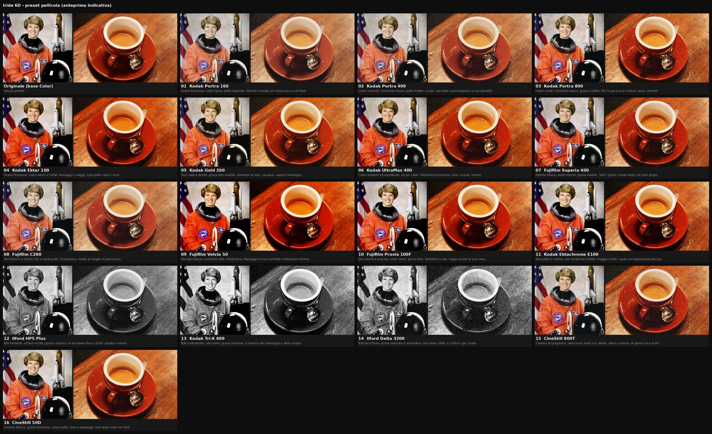

# LightCraft 与 Lightroom 胶片预设

EOS 6D 仅将 Iride 胶卷的色调参数（照片风格、反差、饱和度、色调）应用于 **JPEG** 以及 CR2 文件内嵌预览图。
在 LightCraft 或 Lightroom 中导入纯 RAW 时，软件会先闪现内嵌预览，随后以中性参数解码 RAW，导致胶片质感消失。

本目录提供 16 套与固件一一对应的 XMP 预设，可为 **RAW** 赋予同款胶片风格。

| 文件 | 说明 |
|---|---|
| `xmp/*.xmp` | 16 款胶片预设，标准 Lightroom XMP 格式（`crs:`） |
| `films.py` | 各款胶片的调色参数定义 |
| `make_presets.py` | 生成 XMP 与压缩包：`python3 make_presets.py out` |
| `preview.py` | **参考性**效果预览（近似模拟滑块效果，不等同于 LightCraft 渲染引擎） |



## 导入方式

- **LightCraft**：打开 Presets 面板（`Shift`+`P`）→ **Import Presets…** → 选择 zip 或 `.xmp` 文件，导入后位于 *Iride 6D - Pellicole* 分组。
- **Lightroom Classic / Lightroom**：预设面板 → `+` → **导入预设** → 选择 zip 或 `.xmp` 文件。

## 使用方法

1. 每个胶卷拍出的照片均带有 `Rnnn` 前缀（例如 `R0110017.CR2` 表示第 11 卷），可按前缀批量选中。
2. 应用对应的胶片预设（可在 `ML/LOGS/IRIDE.CSV` 中查阅每卷所用胶片名称）。
3. 预设不会覆盖白平衡：机身拍摄时写入 RAW 的色温（“按拍摄设置”）将完整保留。

## 我的自定胶片（从 6D 配方卡生成预设）

在 6D 胶卷架的 **自定** 分类中可创建最多 4 个个人配方，执行 *保存配方卡到存储卡* 后会生成 `ML/IRIDE/MIA1.TXT`（至 `MIA4.TXT`）。
使用以下命令将其转换为电脑端 XMP 预设：

```bash
python3 make_presets.py --ricetta MIA1.TXT MIA2.TXT 输出目录
```

生成的预设会在基础胶片之上叠加你的自定义调整：反差、饱和度、色调（肤色红橙倾向）、黑白（单色风格时）、颗粒（无/轻/中/强）与暗角。配方卡为纯文本格式，可直接发给好友，在另一台 6D 上用 *从存储卡读取配方* 导入。

所有预设写入相同的参数组，切换不同胶片预设时不会残留上一套的参数痕迹。可通过软件中的 *数量（Amount）* 滑块（0–200%）微调浓淡。

以上参数均为对各款经典胶片视觉特征的风格化还原，而非实验室密度计实测值；胶片品牌名称仅用于风格描述，商标归各自权利人所有。
